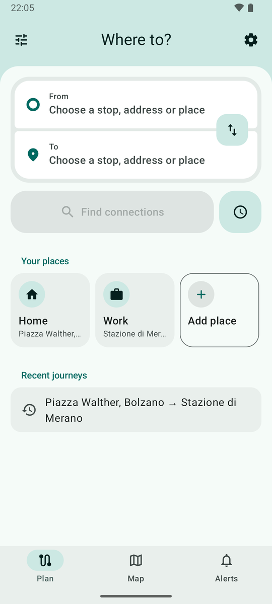
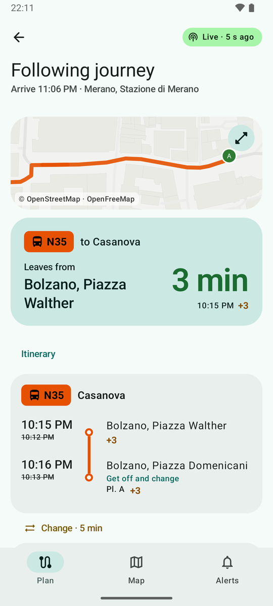
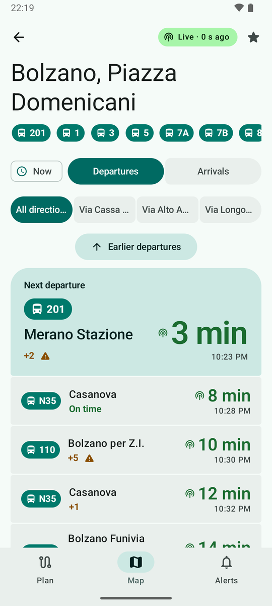
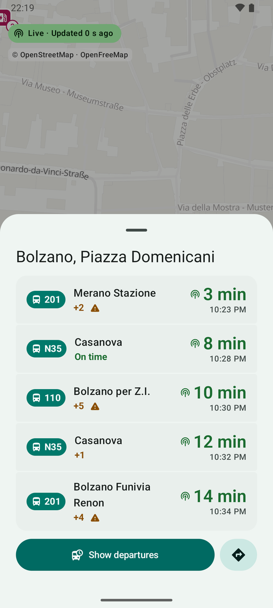
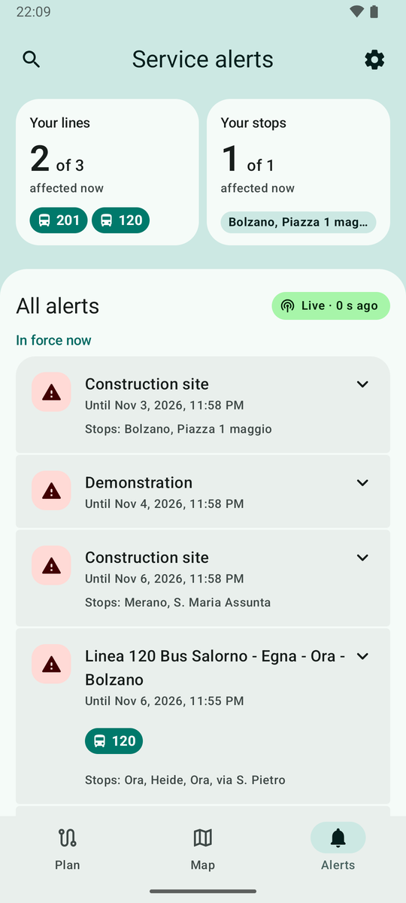
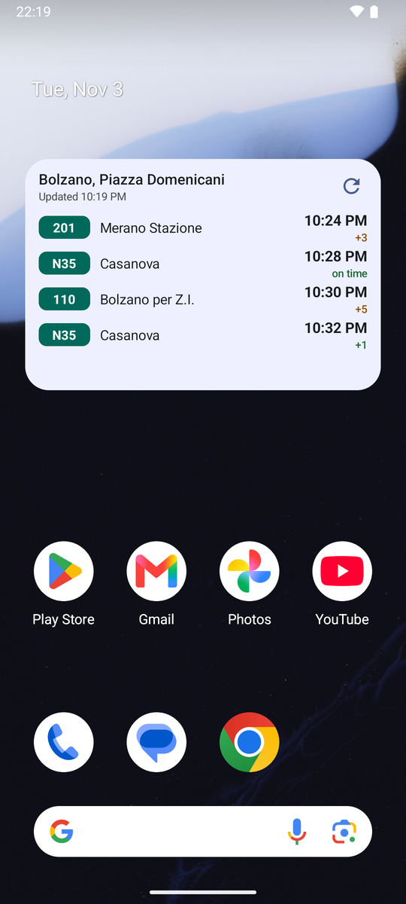

<p align="center"></p>

# South Tyrol Transit

Unofficial Android app for public transport in South Tyrol / Alto Adige: plan a journey, see live departures and vehicles, and get service alerts for your stops and lines. In English, German and Italian, for Android 8.0 and newer.

**[Download the latest APK](https://github.com/ta-samuelece/SouthTyrolTransit/releases/latest)** and open it on your phone; Android will ask you to allow installing from this source. The app then offers its own updates, and Settings → App updates has a Preview channel for early builds.

<table>
  <tr>
    <td align="center"><br><sub>Plan</sub></td>
    <td align="center"><br><sub>Follow a journey</sub></td>
    <td align="center"><br><sub>Live departures</sub></td>
  </tr>
  <tr>
    <td align="center"><br><sub>Map</sub></td>
    <td align="center"><br><sub>Service alerts</sub></td>
    <td align="center"><br><sub>Home-screen widget</sub></td>
  </tr>
</table>

## What it does

- **Plan journeys** by bus, train and cable car, with live delays, fares where the planner reports them, and wheelchair and bike options.
- **Follow a journey or a ride** step by step, with a countdown, a notification and warnings when a connection breaks.
- **Check live departures** at any stop, and add them to your home screen as a widget.
- **Explore the map:** stops, live buses, and optional layers for parking, EV charging, and bike and car sharing.
- **Read service alerts**, and opt in to notifications for your saved stops and lines.
- **Save** places, stops, lines and journeys on your device.

[All screens and features](docs/FEATURES.md)

## Good to know

- **Unofficial.** It is independent of STA, SASA, südtirolmobil / altoadigemobilità and the Province, and uses none of their logos or branding.
- **No tickets.** There is no public API for buying or validating them, so the app links to the official information.
- **Offline.** With the timetable downloaded (about 100 MB), search, scheduled departures and line pages work offline. Planning a journey needs a connection.
- **Live data is partial.** Not every bus reports, and no open source gives train positions, so trains never appear on the map. When data is old, the app says so and shows scheduled times.
- **Vibe coded.** AI assistants (first ChatGPT, then Claude) wrote almost all of it, with a human steering, testing on devices and reviewing the result. It works and has tests, but treat it as a hobby project.

## Data

Built only on open data: STA timetables and GTFS-Realtime via Open Data Hub, the public STA EFA journey planner, Open Data Hub mobility data, OpenFreeMap / OpenStreetMap tiles and the Province of Bolzano's maps. [Licences](docs/DEVELOPMENT.md#licences) · [endpoints](docs/API_DISCOVERY.md) · [known limitations](docs/DEVELOPMENT.md#known-api-limitations)

## Build it

You need JDK 21 and the Android SDK with platform android-37.1, with `sdk.dir` set in `local.properties`. No API keys are required.

```bash
./gradlew assembleGithubDebug
./gradlew :core:model:test :core:data:testDebugUnitTest :app:testGithubDebugUnitTest :app:testPlayDebugUnitTest
./gradlew :app:lintGithubDebug :app:lintPlayDebug
```

The app builds in two flavors with the same package name: `github`, which updates itself from GitHub Releases, and `play`, for Google Play, which has no updater. See [Updates and releases](docs/RELEASING.md).

Changes reach `main` through pull requests from a branch named `<type>/<short-description>`, with type `feature/`, `fix/`, `chore/` or `docs/`.

- [Development guide](docs/DEVELOPMENT.md): architecture, tests, data strategies and limitations
- [Updates and releases](docs/RELEASING.md): how the updater works and how to publish
- [Push backend contract](docs/PUSH_BACKEND.md): for a server that does not exist yet

Found a bug? [Open an issue](https://github.com/ta-samuelece/SouthTyrolTransit/issues/new/choose).

## License

Public domain, via [The Unlicense](LICENSE): do whatever you want with this code. The transit and map data the app downloads keep [their own licences](docs/DEVELOPMENT.md#licences).
