<p align="center"></p>

# South Tyrol Transit

> **This app is vibe coded.** It was written almost entirely by AI coding assistants (first ChatGPT, then Claude) from a
> plain-language brief, with a human steering, testing on devices and reviewing the result. Treat it as a hobby project:
> it works and has tests, but read the code before you rely on it.

Unofficial Android app for public transport in South Tyrol / Alto Adige. Released into the public domain under
[The Unlicense](LICENSE): do whatever you want with it.

## Screenshots

<table>
  <tr>
    <td align="center">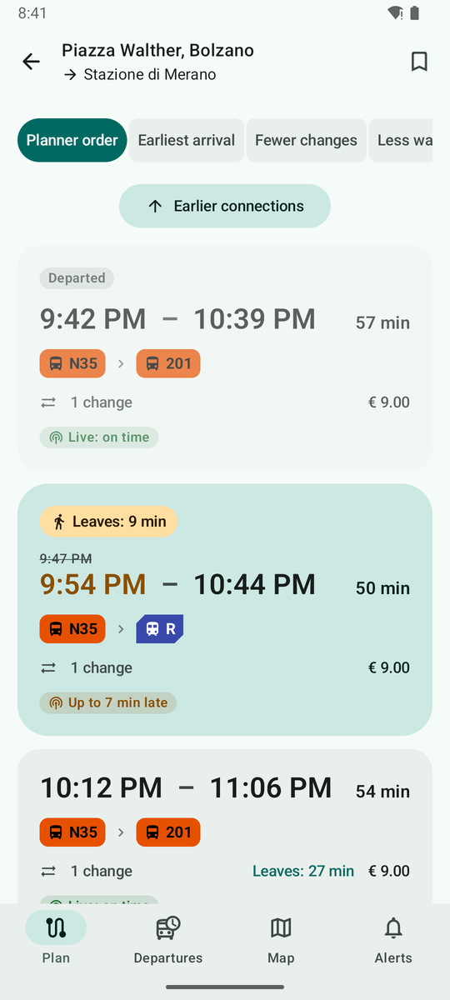<br><sub>Journey results</sub></td>
    <td align="center">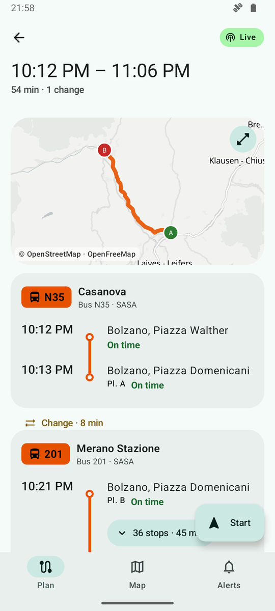<br><sub>Journey detail</sub></td>
    <td align="center">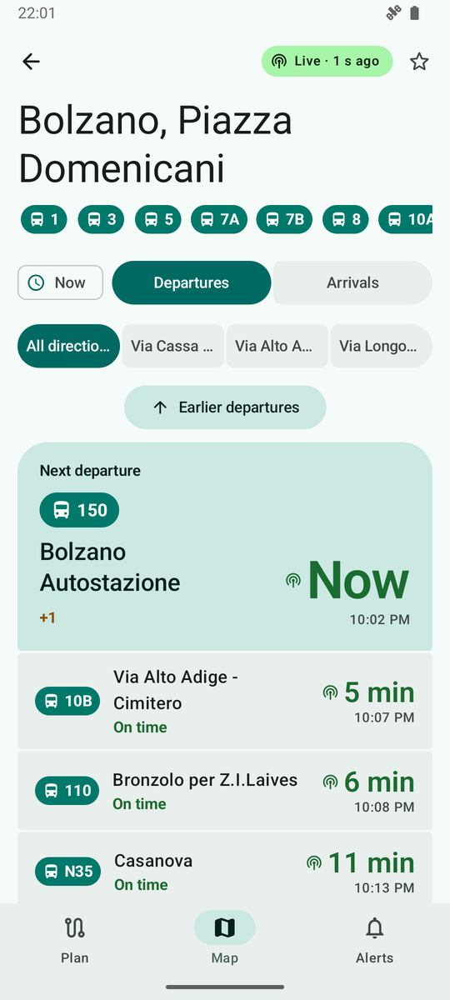<br><sub>Live departure board</sub></td>
  </tr>
  <tr>
    <td align="center">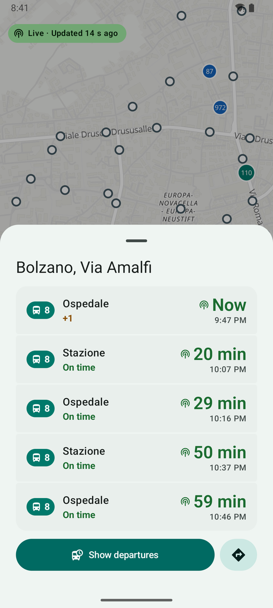<br><sub>Map with stop preview</sub></td>
    <td align="center">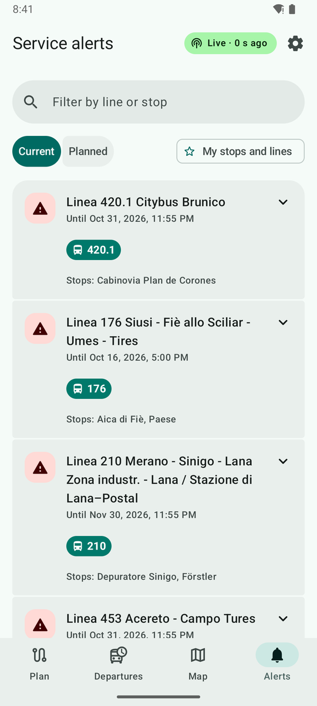<br><sub>Service alerts</sub></td>
    <td align="center">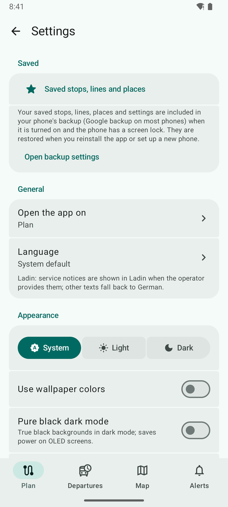<br><sub>Settings</sub></td>
  </tr>
  <tr>
    <td align="center">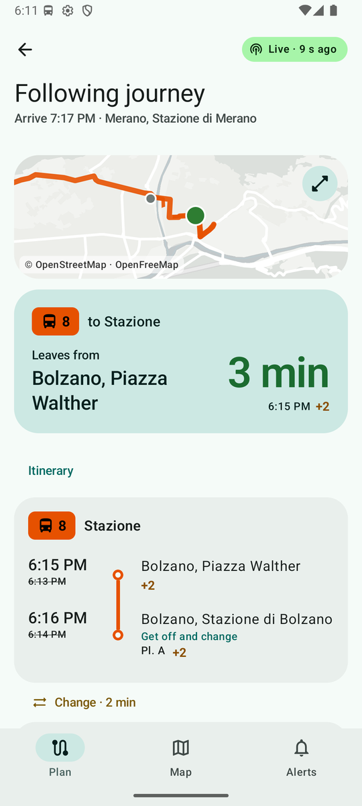<br><sub>Following a journey</sub></td>
    <td align="center">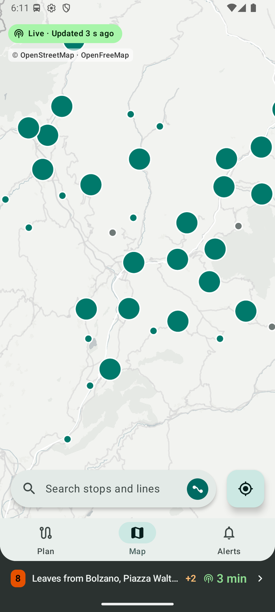<br><sub>The journey, minimised</sub></td>
    <td align="center">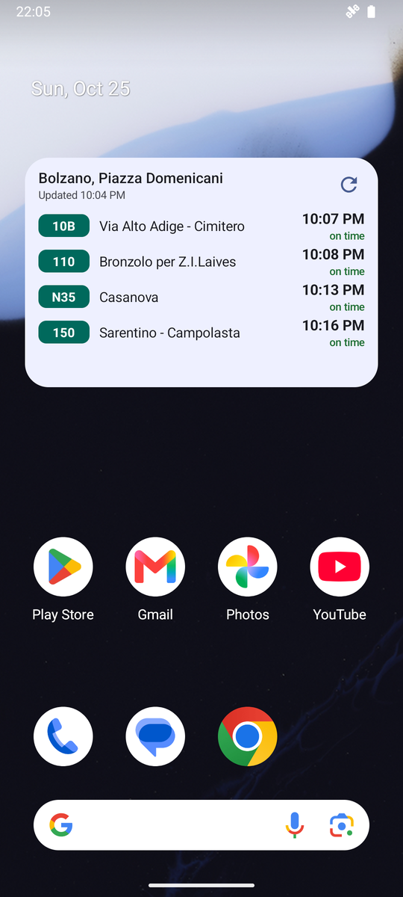<br><sub>Home-screen widget</sub></td>
  </tr>
  <tr>
    <td align="center">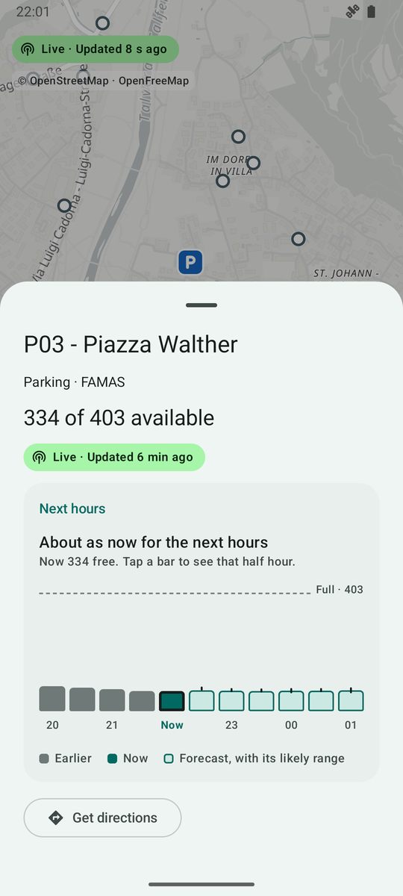<br><sub>Car park forecast</sub></td>
    <td align="center" colspan="2">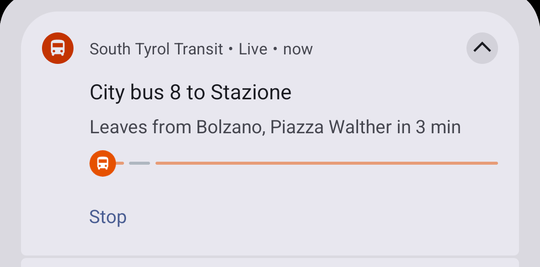<br><sub>Ongoing notification while following</sub></td>
  </tr>
</table>

## 1. Purpose

South Tyrol Transit is a native Android app for public transport in South Tyrol / Alto Adige. It covers journey planning, live departures, line and stop information, live vehicles, service alerts and saved items.

It is built only on legitimate open data:

- STA timetables and GTFS-Realtime via Open Data Hub
- the public STA EFA journey planner
- Open Data Hub mobility data
- OpenStreetMap-based maps

"South Tyrol Transit" and the package id `org.southtyrol.transit` are **placeholders**. The name is in `app_name` in the three `strings.xml` files. The package id is in `app/build.gradle.kts` (`namespace`, `applicationId`) and is also hard-coded in `AppIcons.component` (`ui/AppIcons.kt`), in `MainActivity`'s stop-intent extras and in `android:configure` of `res/xml/departures_widget_info.xml`; change all of them together, or the icon switcher and the widget stop working.

The launcher icons come from the PNGs in `icons/` (default: Alpine Route, a vector icon converted by hand from `icons/Alpine Route.svg` rather than generated; users pick one in Settings → Appearance). Adding one takes five steps: put the PNG in `icons/`; run `python tools/generate_icons.py` (needs `pip install pillow numpy`), which fills the black corners, centres the art so the route stays inside the circular mask and writes the adaptive-icon layers and previews; add an `activity-alias` for it to `AndroidManifest.xml`; add an entry to `AppIcon` in `ui/AppIcons.kt`; and add its `icon_<name>` string to `values`, `values-de` and `values-it`. Never rename an existing alias: a user who picked it would be left without a launcher entry. `res/drawable/ic_launcher_monochrome.xml` is the themed-icon silhouette (mountains and route), `ic_launcher_monochrome_route.xml` the route-only one Gradient Path uses, `ic_launcher_monochrome_alpine_route.xml` Alpine Route's own; `MONOCHROME` in the script picks it per icon.

## 2. Unofficial status

This app is **independent and unofficial**. It is not affiliated with STA, SASA, südtirolmobil / altoadigemobilità or the Province. It uses no official logos, artwork or branding, and says so on the About screen.

## 3. Screens and features

| Area | What it does |
|---|---|
| **First run** | Shown once, on a fresh install (an updated install goes straight to the app). Five steps under a progress bar: language, location permission, notices for saved stops and lines (with the notification permission), the offline timetable over Wi-Fi only or mobile data too, and a few preferences (start tab, theme, wallpaper colours, pure black, wheelchair default). Then a summary that follows the timetable download. Every step has Back and Skip, and each choice is saved as it is made |
| **Plan** (home) | Connected From/To hero with a swap button. Place search (stops, addresses, POIs) in a bottom sheet with "use my location", "pick on the map" (any point or a stop), your places and recents; a star on each result saves it as Home, Work or a place of your own with a name and one of twelve icons. Leave now / depart at / arrive by with date-time pickers. Preferences: fewer changes (the default), fastest, less walking. Mode filters, walking speed, longest walk to a stop (10, 20 or 30 min; 20 by default), wheelchair option, "Travelling with a bike" (hides connections whose matched timetable run takes no bikes; needs the downloaded timetable). "Your places": a sideways-scrolling row of cards with Home, Work, your own places in your order and "Add place"; a tap finds connections from your current location to the place, leaving now, and a long press opens a small FAB-style menu with "Arrive here" and "Start from here". All cards, "Add place" included, have the same height. Saved and recent journeys. Tickets entry |
| **Results** | Journey cards with large dep/arr times, duration, changes, walking, a line chain, live/delay/cancel/notice pills and planner fares. The soonest connection that can still be caught is emphasised with a "Leaves: …" pill; connections that have left are dimmed and marked "Departed". Sorting in a connected button group, earlier/later. Save the journey. Two-pane list/detail on wide screens |
| **Journey detail** | The journey's times are the title of the top bar, duration and changes its subtitle, with the one live/scheduled pill beside them. Map of all legs (walking dashed) and a timeline. Transit legs show line, destination, operator, platforms, scheduled vs live times, the train number, distance and bike rule of the matched timetable run (with a warning when travelling with a bike and the rule is unknown) and expandable intermediate stops, drawn like an opened trip (rail, stop dots, passed stops dimmed, the vehicle before the next stop). Transfer times and leg notices. Above the boarding stop, a row says where the approaching vehicle is ("Bus 211 is 3 stops away", live or estimated) and opens the run's earlier stops with their times on a dashed rail; trains show the times only, as they report no position. The map shows the approaching vehicle too. Fares only when the planner reports them. **Start** follows the journey |
| **Following a journey** | Started from the journey detail; one journey at a time, reopened from the notification or from the strip under the navigation bar, which shows the current step on every other screen (red when the plan breaks). Shows the current step (leaves from, get off at, change at, walk to) with a countdown, then every leg of the itinerary (done ones dimmed, the current one open with its stops), and a map zoomed on the current step. Live times where a timetable run is matched (GTFS-RT), otherwise the planner's times, marked as such. Warns when a leg is cancelled, a connection can no longer be made, or (with the optional location) a boarding was missed or the route left, and offers "Find another way". An ongoing notification with Stop shows the step; on Android 16+ it is a Live Update with a progress bar per leg and a status bar chip. Runs in a foreground service only while following; ends by itself on arrival, and is lost if Android ends the app |
| **Following a ride** | One bus or train run pinned from the map's vehicle sheet ("Follow this ride") or from its trip screen ("Follow ride"). Shares the journey's single slot: following a ride while a journey or another ride is followed first asks whether to follow it instead. The same strip under the navigation bar shows where the run is on every other screen (leaves from, next stop, at a stop, last seen near a stop when its GPS position is not current, red when it is cancelled) and opens its trip, where a card on top says the same with a countdown and the last stop, and Stop following sits at the bottom. The position comes from the vehicle's GPS when there is one, otherwise it is estimated from live times or the timetable and said so, so trains can be followed too. An ongoing notification with Stop says the same; on Android 16+ a Live Update with the run's progress and a status bar chip counting down to the next stop. Ends by itself a minute after the last stop (or a cancellation), leaving a final notice; is lost if Android ends the app |
| **Stop** | Live departures/arrivals with countdown, delay text, platform, train number, bike symbol, cancellation and alert flags; on the live departure board the next departure is a large hero card heading the list, with "Bikes allowed" and the distance to its destination when the timetable gives them. Below the served lines (one sideways-scrolling row of filter badges, saved lines first): the time chip ("Now" or a chosen time, with a close icon back to now) with departures/arrivals filling the rest of the row and the wheelchair mark beside it, then the direction choice across the full width. Earlier/later departures are tonal buttons, "earlier" right above the hero card. The freshness pill ("Live · 16 s") sits in the top bar beside the favourite. Pull to refresh. Platform map, favourite |
| **Trip** | One collapsed card above the timeline summarises this line's/run's service notices; tap it to expand every notice in full. Train number, run length and bike rule in the header; with a fresh GPS position, distance travelled and to go, and "Next stop in …". Stop-by-stop timeline with scheduled/predicted times, distance along the run per stop, skipped stops, next-stop highlight, live vehicle on the shape map with its age |
| **Lines** | Line search (also reached from the map's search). Line page with directions, ordered stops, shape map, live vehicles, upcoming trips, alerts, operator, favourite |
| **Map** | MapLibre (OpenGL ES) map with clustered stops (white dots ringed in their mode's colour; train and cable car stations become a disc with their icon from zoom 15, and a red badge marks a stop named by a service alert in force; the mode needs the downloaded timetable), live vehicles (mode icon with the line number and a bearing arrow, grey when stale, hidden after 10 min) and optional parking / car-sharing / EV charging / bike box / e-bike sharing / bike sharing layers, grouped in the layers sheet by public transport, car and bike, drawn as rounded-square icons with a live availability count when zoomed in; a charging station counts its free points, carries a bolt badge when it has a DC point of 50 kW or more and turns grey when every point is out of order. STA's bike boxes (Bicibox, a bike inside a box on dark cyan) count free boxes or depot places and, when a site is full, point to the nearest one nearby with space; Ecospazio's e-bike sharing stations count e-bikes to rent and free docks, and turn grey while closed. Saved stops highlighted. Four map types: Standard (OpenFreeMap Positron, Fiord in dark mode, Dark Matter with pure black), Detailed (OpenFreeMap Liberty, the same in every theme), and the Province of Bolzano's Aerial and Topographic maps, which cover South Tyrol only, from zoom 10, over the standard map. MapLibre logo/info button removed; a compact credit naming every source shown remains (ODbL). A search bar floats at the bottom, sharing the row with the "my position" button (or at the top, as chosen in Settings), with the ringed app mark at its end, which opens a Material FAB menu with Saved, the language (opening the language choices), the theme (each tap switches System, Light, Dark at once) and Settings, rising above the bar, or dropping below it when the bar is at the top; with the bar at the bottom the map credit moves to the top, under the live pill: tapping it covers the map with a search view (the bottom bar hides meanwhile) that shows saved stops, recent searches (the stops and lines last opened from it, newest first, with a Clear button) and nearby stops (location on demand), and while typing matching stops and lines; a stop opens its departure board, a line its line page, and back returns to the search, then to the map with the text cleared. Above the "my position" button, a layers button of the same size opens a sheet with the map type and the same layer toggles as Settings. With location allowed, the user's position is a blue dot that follows every fix while the map is on screen (GPS and compass stop in the background), with a halo for its accuracy and a cone that turns with the compass; the camera does not follow it. Besides these, only the "my position" button (muted secondary tone) floats over the map: a tap centres on the user, a long press opens the saved stops as a FAB menu, and picking one flies to the stop and opens its sheet (a one-time snackbar points this out once a stop is saved); the map type, which layers are shown, whether the layers button is shown, where the search bar sits and where that button sits (bottom right, bottom left or hidden) are chosen in Settings. An empty vehicle feed is noted in the freshness pill rather than a banner. Stop sheet with the next departures, a "Show departures" button and a directions icon button; vehicle sheet with line, destination, next stop, delay and freshness; charging-station sheet with its points grouped by connector, power and cable, each group's free count, opening hours, access and a payment link where the operator gives them; car park sheet with a "Next hours" bar chart (two hours measured, now, and the operator's forecast up to about three hours ahead with its likely range), tappable per half hour, for car parks that publish a forecast issued within the last 90 minutes |
| **Alerts** | Current and planned alerts merged from GTFS-RT and EFA AddInfo, deduplicated. Filter by line or stop (a filled search field; tapping a line badge filters to it) and to my stops/lines; Current/Planned in a connected button group filling the row, with the starred "My stops and lines" filter on the right; the freshness pill sits in the top bar. Alerts form one grouped list; disruptions and other notices differ by the colour of their icon container, and affected lines show as line badges with their mode icon (lines named only in planner notices are looked up by name). Multilingual (de/it/en/lld) with a language switcher. Validity periods. Stale marking offline |
| **Saved** (in Settings) | Places, stops, lines, journeys and recents; add places, stops (search or map) and lines. Places list Home and Work first, then your own, which can be renamed, given another icon and moved up or down; any place can get a new location or be removed. Saved stops and lines drive the Alerts "My stops and lines" filter and alert notifications. Stored on the device; saved items, settings and the app icon are included in the phone's automatic backup (Android 9+, end-to-end encrypted only; recents are not) |
| **Settings** (in the menu behind the app mark in the map's search bar) | Grouped lists under section headings, each setting on its own segment. One-of-many choices (start tab, language, "my position" button) are rows that open a choice dialog; the theme is a connected button group; the app icon is a row that opens a sheet with the variants; map layers stay filter chips (several can be on). Saved items, start tab, map layers, search bar position (bottom by default, or top) and "my position" button placement, language (system/en/de/it), theme (system/light/dark), pure black dark mode, wallpaper colors (off by default), wheelchair default, opt-in alert notifications, offline timetable status/download/mobile-data/FTP-fallback, app updates (Stable or Preview channel) |
| **Navigation** | Bottom tabs Plan / Map / Alerts (stop search lives in the map's search; a stored "Stops" start tab opens the map); Settings is a screen opened from the menu behind the app mark in the map's search bar, not a tab. The tab stays selected inside its sub-views; tapping the current tab returns to its root. Sub-views slide in horizontally (Material shared-axis style) so predictive back animates them; tab switches and reduced-motion use a fade |
| **About / Tickets** | Unofficial disclaimer, data sources and licences, privacy. Explanation that tickets are sold by the official service, with a link |

## 4. Architecture overview

- Kotlin, Jetpack Compose (Material 3 Expressive), coroutines and Flow/StateFlow, ViewModel.
- Type-safe Navigation Compose, Hilt (KSP), Room, DataStore, WorkManager, OkHttp, kotlinx-serialization, GTFS-Realtime protobuf bindings, MapLibre.
- **Layers.** UI (screens + ViewModels) → repositories → data-source interfaces → implementations. ViewModels only see domain models (`core:model`) and never know whether data came from GTFS, GTFS-RT or EFA.
- **Interfaces** (`core/model/.../Interfaces.kt`):
  - `TransitScheduleDataSource` (GTFS)
  - `RealtimeTransitDataSource` (GTFS-RT)
  - `JourneyPlannerDataSource`, `GeocodingLocationDataSource`, `DepartureBoardDataSource`, `AlertDataSource` (EFA)
  - `MobilityDataSource` (ODH)
  - `TicketingProvider` (official link only)
  - `PushBackend` (no-op until a server exists)
- **Merging.** `DepartureRepository`, `TripRepository` and `AlertRepository` combine static schedule, realtime snapshot and alerts. `RealtimeMerge` implements GTFS-RT delay propagation, cancellation, skipped stops and staleness. `FreshnessPolicy` holds the explicit rules.
- **Live screens** poll through `PollWhileVisible` (`repeatOnLifecycle(STARTED)`), so nothing polls in the background. Per-feed throttling in `RealtimeRepository` prevents duplicate requests when several screens are open.
- **Map** is provider-agnostic: features use `TransitMap(MapContent…)`. MapLibre lives in one file (`MapLibreTransitMap.kt`). The project uses the OpenGL ES build (`org.maplibre.gl:android-sdk-opengl`): the default Vulkan build crashed the Android emulator's software GPU and is riskier on older devices at minSdk 26.

## 5. Modules

| Module | Contents |
|---|---|
| `core:model` | Pure Kotlin/JVM: domain models, GTFS time and calendar logic, realtime merge, freshness policy, multilingual fallback, alert dedupe, geo/polyline/contrast utilities, data-source interfaces |
| `core:data` | Android library: network (`TransitHttp`), CSV, GTFS importer and schedule store (Room, one DB file per feed version), GTFS queries, EFA client/parsers, GTFS-RT parser and repository, ODH mobility, repositories, DataStore settings |
| `core:designsystem` | Theme (`MaterialExpressiveTheme`, fallback palette, motion schemes), status colors, mode colors/shapes, components (line badges, countdown, delay/freshness labels, banners, expressive loading, empty/error states, connected toggle group), formatting |
| `core:map` | `TransitMap` API and MapLibre implementation |
| `app` | Application, DI, navigation, feature screens (`feature.*` packages), workers, location |

Features are packages inside `app` rather than modules. That keeps AGP configuration and build times small; splitting them out later is mechanical.

## 6. Public APIs and data sources

See **[docs/API_DISCOVERY.md](docs/API_DISCOVERY.md)** for endpoints, fields, refresh behaviour, error handling, confidence and what is deliberately not used. In summary:

- **Static GTFS**: `gtfs.api.opendatahub.com/v1/dataset/sta-time-tables/raw`, with a fallback to STA's own `ftp.sta.bz.it` publication point.
- **GTFS-Realtime**: `files.opendatahub.com/gtfs-rt/feeds/sta/*.pb`, the sources listed in ODH `datasets.yml`, with a fallback to `gtfs.api…/v1/realtime`.
- **STA EFA XML**: `efa.sta.bz.it/apb/`, covering StopFinder, Trip, DM, Coord and AddInfo.
- **ODH Mobility v2**: parking, bike sharing, car sharing, EV charging stations (stations, their charging points and each point's status, joined in the app), STA's Bicibox bike boxes and Ecospazio's e-bike sharing (sites and their latest values, joined in the app).
- **OpenFreeMap** tiles: the standard map is Positron in light mode, Fiord in dark mode and Dark Matter with pure black on (one design in three colourings); the Detailed map type is Liberty in every theme, as it has no dark variant.
- **Province of Bolzano WMTS** (`geoservices.buergernetz.bz.it`): the 2023 orthophoto and the topographic map for the Aerial and Topographic map types.

## 7. Data licensing

- STA timetable, realtime and EFA data: **CC0**. Credited anyway on the About screen.
- ODH Mobility: open data published by Open Data Hub.
- Map: OpenFreeMap tiles; data © OpenStreetMap contributors (**ODbL**). Aerial and topographic maps: Autonomous Province of Bolzano geodata (**CC0**). Attribution is shown in the map and on the About screen.
- App code: public domain via **[The Unlicense](LICENSE)**. Use, copy, modify, sell, relicense: no conditions, no attribution required. (The data licences above still apply to the data.)
- Libraries: every library in the release APK is under a permissive licence - Apache 2.0 (AndroidX, Kotlin, kotlinx, Dagger/Hilt, OkHttp, Okio, Gson, Guava, Timber, GTFS-realtime bindings, MapLibre parts) or BSD (MapLibre Android SDK, protobuf, parts of AndroidX). That is compatible with releasing the app's own code under the Unlicense. Apache 2.0 and BSD ask that licence texts and copyright notices ship with the APK: the app lists every library with its licence under Settings → Open-source licences (also linked from About). The list is generated at build time by the AboutLibraries Gradle plugin; the real BSD notices (with copyright lines) come from `app/licenses-config/`.

## 8. Setup

Requirements:

- JDK 21. The Android Studio bundled JBR works.
- Android SDK with platform **android-37.1** and build-tools 37.

Steps:

1. Point `local.properties` at your SDK: `sdk.dir=...`.
2. Optionally add map style overrides:
   ```properties
   # local.properties (never commit secrets)
   map.styleUrl=https://example.org/style.json
   map.styleUrlDark=https://example.org/dark.json
   ```
   Environment variables `TRANSIT_MAP_STYLE_URL` and `TRANSIT_MAP_STYLE_URL_DARK` also work.

## 9. Map and API keys

**No keys are required.** All sources are keyless. If you switch to a keyed tile provider, put the full style URL (including the key) in `local.properties` or an environment variable. It is injected into `BuildConfig` and never committed: `local.properties` is git-ignored.

## 10. Build

```bash
./gradlew assembleDebug            # app/build/outputs/apk/debug/app-debug.apk
./gradlew assembleRelease          # R8-minified; configure signing first
./gradlew lintDebug                # Android Lint (abortOnError)
```

The release APK carries native code (MapLibre) only for ARM (`arm64-v8a`, `armeabi-v7a`), which is every phone; leaving out x86/x86_64 saves about 22 MB. Debug builds keep all four, so they still run on an x86_64 emulator. To try a release build on an emulator, use an ARM64 system image or one with ARM translation.

## 11. Tests

```bash
./gradlew :core:model:test :core:data:testDebugUnitTest :app:testDebugUnitTest
./gradlew :app:connectedDebugAndroidTest           # on a device/emulator
# Optional: import the real 150 MB STA feed and join it with captured realtime
./gradlew :core:data:testDebugUnitTest --tests '*RealFeedTest*' -PgtfsReal=/path/to/google_transit_shp.zip
```

- **Unit (`core:model`)**:
  - GTFS times beyond 24:00
  - calendar and calendar_dates logic
  - DST spring/fall
  - Europe/Rome independent of device zone
  - realtime delay, early running, propagation, NO_DATA, cancellation, skipped stops, staleness
  - vehicle freshness
  - multilingual fallback incl. Ladin
  - alert dedupe and validity
  - polyline, simplification, contrast
- **Unit (`core:data`)**:
  - CSV edge cases
  - EFA parsing of trip, walking, fares, DM, coord, AddInfo, StopFinder, error -8020, DTD rejection and malformed XML, using real captured fixtures
  - trip parameter building, including date/time in Europe/Rome
  - GTFS-RT trip updates, vehicles and multilingual alerts
  - mobility freshness, charging stations joined from real captured station, point and status payloads, bike boxes and e-bike sharing stations from real captured site and value payloads, and parking forecasts built from a real captured forecast and history
  - MockWebServer: retries, 404, 429 with Retry-After, 5xx, timeouts, disconnects, malformed and empty payloads
  - importer joins, past-midnight trips, calendar exceptions, translations, terminating trips, atomic swap and rejection of broken feeds (Robolectric)
  - network-board fallback, realtime/alert merge and stale handling, offline place search, cached alerts going stale offline, saved items
- **UI components (Robolectric Compose, `app/src/test`)**: individual components rather than whole screens - the journey search request surviving navigation, a journey result card, a departure row (countdown, delay, opening the trip, cancellation label), an alert card (expanding, switching language), the offline and location-denied states, the first-run screens' frame (back, skip, no progress bar on the summary). No screen or ViewModel is tested end to end.
- **Other app unit tests**: translations complete in en/de/it, the in-app updater's version and release parsing, release-notes Markdown, licence text formatting.
- **Instrumented (`app/src/androidTest`)**: EFA parsers on the device's XML stack, plus a developer helper that imports a pushed GTFS zip:
  ```bash
  adb push google_transit_shp.zip /data/local/tmp/sta.zip
  adb shell am instrument -w -e feed /data/local/tmp/sta.zip -e class org.southtyrol.transit.ImportFeedOnDevice org.southtyrol.transit.test/androidx.test.runner.AndroidJUnitRunner
  ```

Fixtures live in `docs/fixtures`.

### Branches and pull requests

`main` only changes through pull requests, and CI ("Tests and lint") must pass before one can be merged. Name your branch `<type>/<short-description>`: the type is `feature/`, `fix/`, `chore/` (build, tooling, CI, releases) or `docs/`, followed by a few lowercase words describing the change, joined by dashes, e.g. `feature/places-cards` or `fix/search-reload-loop`. CI fails a pull request from any other branch name; rename the branch (`git branch -m <new-name>`) and open a new pull request.

## 12. Static GTFS update strategy

1. **Schedule.** `ScheduleSyncWorker` (WorkManager) runs weekly, plus once as soon as possible on installs that have no timetable yet, with battery not low and storage not low, and on unmetered network unless "Download over mobile data" is on. The user can "Download now" over any network. A downloaded feed that fails validation is not retried; network failures are retried up to three times. Each time the app opens (except right after the first-run screens), it also checks the timetable itself: when it is missing or cannot be read, when its last service day has passed, or when the HTTPS source reports a newer feed than the installed one (a conditional request whose body is never read, compared by ETag or Last-Modified) or the importer changed since it was built, a dialog offers "Download now" (any network) or "Later" (until the next app start). An expired timetable is not offered again when the server confirms there is nothing newer, nor while a download is running; the dialog waits for the app-update offer, if one is showing.
2. **Download.** Over HTTPS the request is conditional (ETag / Last-Modified) when the previous feed came from the same source; the download has no overall time limit, only a read timeout, so slow connections can finish. If the HTTPS source fails and the setting allows it, the STA FTP mirror is used; FTP downloads are always complete (no conditional request) and resume after dropped connections.
3. **Skip unchanged feeds.** If the SHA-256 is unchanged and the database was built by the current importer (`GtfsImporter.VERSION`), nothing is imported. Bumping that version makes every install re-import its current feed on the next sync, and makes the start-up check offer that download to every user.
4. **Import.** The feed is streamed into a **new SQLite file**:
   - Integer surrogate keys and indexes for stop, trip, station and stop-time lookups, plus an FTS4 stop-name index (all languages, accent-folded).
   - Shapes are simplified (Douglas–Peucker, 4 m) and stored as encoded polylines.
   - Headsign translation gaps are filled with a text dictionary.
5. **Validate.** The import checks required files, the timezone and referential integrity (more than 1 % broken stop_times is rejected).
6. **Activate.** An atomic pointer rename switches to the new file and old files are deleted. An interrupted or failed import never touches the working schedule.
7. **Real feed (4 Oct 2026):** 6,436 stops, 57,316 trips, 1.1 M stop_times. 15 s import on desktop (expect 1–3 min on a phone; the sync shows an ongoing notification without a percentage, and Settings shows the download and import progress). 96 MB database. Departure board query about 60 ms.

## 13. Realtime update strategy

- Trip updates and vehicle positions are fetched as protobuf **only while a live screen is visible**: 30 s on boards and lines, 20 s on map and trips. They are throttled to at most every 20 s per feed across screens.
- Where GTFS-RT has no prediction, boards and trips fall back to the live times of the STA journey planner (EFA). This is the only live source for trains: STA's GTFS-RT feeds carry buses only (checked 24 Oct 2026). A trip opened without a planner reference (from a line page, for example) finds its run on the planner's board at its next station, at most every 2 min while the planner has nothing for it and never while GTFS-RT covers it.
- No open source gives train positions, so trains never appear as vehicles on the map. The trip screen places a train by its live or scheduled times and says it is an estimate.
- Alerts are fetched at most every 2 min (GTFS-RT) and 10 min (EFA AddInfo), and cached on disk.
- Freshness rules (`FreshnessPolicy`):
  - Trip predictions older than 5 min are ignored.
  - A feed not fetched for 3 min counts as unavailable.
  - Vehicles are dimmed after 2 min and hidden after 10 min.
- Every live value shows its age. When data is stale the UI shows scheduled times and says so.

## 14. Offline behaviour

Available offline:

- downloaded timetable: stop and line search, nearby stops, departure boards (scheduled), trips, line pages
- route shapes
- saved items and recents
- the last alerts, marked **stale** with their age

Place search falls back to timetable stops. Journey planning needs the EFA service and says so; no offline router is claimed. Realtime is never shown as live from cache. Without a downloaded timetable, boards use the online EFA departure monitor and say so, and the map shows stops from the EFA coordinate search around the visible area.

## 15. Localization

- UI in **English, German and Italian**, using Android resources only and per-app language selection (Android 13+ system UI; AppCompat storage on older versions).
- Ladin is not a UI language (it was up to 0.1.6-preview.4, with the UI in German); anyone who had chosen it is switched to German. Alert texts in Ladin from the feeds (GTFS-RT `lld`, EFA `ld1/ld2`) are still understood, but shown only as a fallback.
- GTFS stop names and headsigns use German translations for de and the Italian base names otherwise. EFA requests use the app language (StopFinder uses de/it; see API quirks).
- All clock times are shown in Europe/Rome.

## 16. Known API limitations

- **Date format pitfall (fixed).** EFA silently ignores `itdDate` values with a UTC offset. `DateTimeFormatter.BASIC_ISO_DATE` adds one for zoned values, so the app uses `yyyyMMdd`; a unit test covers this.

- `gtfs.api.opendatahub.com` returned **502** for all dataset/realtime paths on 4 Oct 2026. Hence the fallbacks.
- EFA StopFinder ignores `language=en` (it returns "not identified") and matches names per language. The app queries de and it in parallel and merges the results.
- When EFA StopFinder "identifies" a query, it returns only that one place and drops other matches. With the timetable downloaded, the planner's place search adds the timetable stations EFA left out.
- EFA lists one stop under each of its names with the same id ("Fermata autobus a lunga percorrenza Merano Maia Bassa" and "Stazione di Merano Maia Bassa"). The app keeps the name that matches the query best.
- EFA caps the walk to and from stops at 10 minutes unless `trITMOTvalue100` says otherwise, which hides "walk further to a direct bus" connections. The app sends the planner's walking limit (20 minutes by default).
- `routeType=LEASTINTERCHANGE` also returns trips that leave before the requested time (or, arriving by, arrive after it). The app drops them.
- GTFS has no route colours, `feed_info`, transfers or fares. `trip_short_name` (train numbers) and `bikes_allowed` are imported and shown, but were empty in every sampled row (buses only); whether STA fills them for trains is not yet known. Nothing is shown when they are empty. Translations cover German only, and headsigns only partly.
- Realtime coverage is partial: about 57 trip updates and 135 vehicles at a time. Vehicles not matched to a trip show "trip unknown".
- The vehicle feed puts many buses (most city lines, some regional ones) on their line's run scheduled two hours earlier, the UTC offset; their trip updates name the same wrong run. With a downloaded timetable the app moves each such bus, and its updates, to the run of its line and direction due at its stop now.
- Bike and car sharing data for South Tyrol on ODH is sparse or stale, so those layers are off by default. Bolzano's bike sharing stopped updating on 26 Sep 2026 and Merano's on 31 Dec 2025, so while no bike sharing station anywhere in South Tyrol has reported within 7 days, its switch is hidden in the layers sheet and in Settings (checked at most every 6 hours; an offline start keeps it).
- Bike boxes and e-bike sharing are off by default. No bike box site has places with a socket yet, so the split by socket stays hidden; the booking link is not published, so the sheet has none. Most Ecospazio stations report OFFLINE or OUT_OF_SERVICE outside the season and are drawn grey.
- EV charging is off by default too. Operators report a charging point's status only when it changes, so a status counts as current for up to 7 days and is shown with its time, never as live. About 230 stations from one import have no status at all, route220's status is a bare 0 or 1 whose meaning is undocumented (shown as unknown), hydrogen dispensers in the same feed are left out, and no operator publishes prices.
- EFA `infoLinkURL`s point to an internal network address and are not opened.

## 17. Ticketing limitation

There is **no public API** to buy or validate tickets. The app never imitates tickets, QR codes or accounts. The Tickets screen explains this and links to official information. Fares are shown only when the EFA planner reports them, labelled as planner-reported. `TicketingProvider` is the integration point if a legitimate API appears.

## 18. Notification / backend limitation

Background notifications are an **opt-in periodic check (about 30 min, best effort)** using WorkManager, and the settings text says so. True realtime push requires a server; the contract is in **[docs/PUSH_BACKEND.md](docs/PUSH_BACKEND.md)** (`PushBackend` interface, no-op by default). No reference server is included.

## 19. Material 3 Expressive dependency status

- Expressive APIs (`MaterialExpressiveTheme`, `MotionScheme.expressive()`, `LoadingIndicator`/`ContainedLoadingIndicator`, `ToggleButton` connected groups, `SegmentedListItem`, `HorizontalFloatingToolbar`, `LargeFlexibleTopAppBar`, `MaterialShapes`, `LinearWavyProgressIndicator`, expressive `NavigationSuiteScaffold`/`NavigationSuiteItem`) exist only in the **prerelease** line.
- The project pins `androidx.compose.material3:material3:1.5.0-alpha29` and Compose `1.13.0-alpha01`, the version material3 is built against. Stable 1.4.0 lacks these APIs.
- Opt-ins are explicit per file (`@file:OptIn(ExperimentalMaterial3ExpressiveApi::class)`), and most usage is wrapped in `core:designsystem`.
- When animations are disabled system-wide, the theme switches to the standard motion scheme and static progress.

Toolchain: AGP 9.4.1, Kotlin 2.4.20, Gradle 9.8.0, compileSdk 37.1, targetSdk 37, minSdk 26.

## 20. Future improvements

- Offline routing (e.g. RAPTOR over the GTFS DB) and an offline place index.
- The FCM push backend from `PUSH_BACKEND.md`.
- Accessibility pathways/levels if the feed adds them.
- Screenshot tests (Roborazzi) for key screens, and baseline profiles.
- Widgets and Wear OS tiles for saved stops.
- Better vehicle-to-trip matching when `trip_id` is missing (via block/route + position).
- Replace the EFA departure board with SIRI-ET if published officially.
- Line colour mapping (operator-provided) once available.

## In-app updates and publishing a release

The app updates itself from **GitHub Releases** of
[ta-samuelece/SouthTyrolTransit](https://github.com/ta-samuelece/SouthTyrolTransit). There are two **update channels**,
chosen in Settings → App updates:

| Channel | Offered | GitHub |
|---|---|---|
| **Stable** (default) | finished releases only | normal releases, tag `vX.Y.Z` (asks `releases/latest`, which never returns a pre-release) |
| **Preview** | the newest of previews *and* stable releases | pre-releases, tag `vX.Y.Z-preview.N`, plus normal releases (asks the release list) |

- The check runs on start (switchable) and on "Check for updates"; switching channel checks right away.
- If the release's version is newer than the installed `versionName`, the app offers it with its notes:
  **Update**, **Later** or **Skip this version**. Previews are labelled "Preview update available".
- Versions compare numerically, and a preview ranks below the finished version: `0.2.0-preview.1` < `0.2.0-preview.2` <
  `0.2.0`. So preview testers are moved onto `0.2.0` when it ships, and stable users never see a preview.
- Going back from Preview to Stable never downgrades: the preview stays installed until a newer stable version exists.
- The APK asset (a name containing `release` or `preview` is preferred; `debug` builds are never preferred) is downloaded
  with progress. Before installing, the app checks that the APK is **this app**, has a **higher `versionCode`**, and is
  signed with the **same certificate** as the installed app.
- It then opens Android's package installer. The first time, Android asks to allow "install unknown apps" for this app,
  and every install needs the user's confirmation. Nothing installs silently.
- The downloaded APK is deleted on the next app start once it is installed (any file in the download folder that is not newer than the running version goes).
- The repository is set by `update.repo` in `local.properties` (or `TRANSIT_UPDATE_REPO`). Set it to `none` to build
  without updates (e.g. for an app-store build).

### Signing key (once)

Every release, stable or preview, must be signed with the **same key**: Android refuses updates signed with another one,
so losing the keystore means users must uninstall and reinstall. Create it once, keep it and its passwords safe and out of
git:

```bash
keytool -genkeypair -v -keystore release.jks -alias southtyroltransit -keyalg RSA -keysize 4096 -validity 36500
```
```properties
# local.properties
release.storeFile=/absolute/path/to/release.jks
release.storePassword=...
release.keyAlias=southtyroltransit
release.keyPassword=...
```
(or the environment variables `TRANSIT_RELEASE_STORE_FILE`, `TRANSIT_RELEASE_STORE_PASSWORD`, `TRANSIT_RELEASE_KEY_ALIAS`,
`TRANSIT_RELEASE_KEY_PASSWORD`). `assembleRelease` then signs automatically.

### Publishing a release (stable or preview)

1. **Choose the version** in `app/build.gradle.kts`:
   - `versionCode`: **always +1**, for every build you publish, preview or stable. The app refuses an update whose
     `versionCode` is not higher than the installed one.
   - `versionName`: stable `0.2.0`; preview `0.2.0-preview.1`, then `0.2.0-preview.2`, … and finally `0.2.0` for the
     finished release.
2. **Write the notes** in `docs/release-notes/<versionName>.md`, e.g. `0.2.0-preview.1.md` (headings, bullets, **bold** and links are shown formatted in the app).
3. **Merge** both into `main` through a pull request. `main` is protected: direct pushes are rejected, and only a repository admin (or the Release workflow, after the owner's approval) can create the `v*` tags a release needs. The release is tagged on the merged commit.
4. **Publish from GitHub**: *Actions → Release → Run workflow*, pick `preview` or `stable`, then approve the waiting deployment. The workflow checks that the channel, `versionName` and notes file agree, builds the signed APK with the signing key stored as secrets of the `release` environment, and runs `tools/release.py`, which publishes it.

Or publish from your own machine instead of step 4: check out `main` and pull, build the signed APK with `gradlew assembleRelease` (output `app/build/outputs/apk/release/app-release.apk`), and run the script (needs Python 3 and `JAVA_HOME` set, e.g. to Android Studio's `jbr`):
   ```bash
```bash
python tools/release.py --preview --notes docs/release-notes/<versionName>.md --dry-run   # checks only
python tools/release.py --preview --notes docs/release-notes/<versionName>.md             # publishes the preview
python tools/release.py --notes docs/release-notes/<versionName>.md                       # a stable release
```
The script checks that the version matches the channel, that the APK is signed and has exactly that version, that everything is committed and the commit is on `origin/main`, and that the tag is new. Then it creates the tag and the GitHub release on that commit (previews as **pre-release**, never marked "latest"), adds a "Preview build" note to previews and uploads the APK as `SouthTyrolTransit-<version>.apk` (previews) or `SouthTyrolTransit-<version>-release.apk`. Locally it uses the GitHub login git already has; in the workflow, the workflow's own token.

#### Signing secrets for the Release workflow

The workflow signs with the same key as local builds, stored as secrets of the `release` environment (*Settings → Environments → release*): `TRANSIT_RELEASE_STORE_BASE64` (the keystore file, base64-encoded), `TRANSIT_RELEASE_STORE_PASSWORD`, `TRANSIT_RELEASE_KEY_ALIAS` and `TRANSIT_RELEASE_KEY_PASSWORD`. A fifth secret, `TRANSIT_RELEASE_GITHUB_TOKEN`, is the owner's fine-grained personal access token (only this repository, permission *Contents: Read and write*): the release is created with it because only an admin may create `v*` tags, and the workflow's own token is not an admin. When it expires, set a new one. Only the repository owner sets these secrets, by hand. GitHub secrets cannot be read back, so they are not a backup: keep the keystore safe elsewhere too. The `release` environment only runs from `main` and waits for the owner's approval, so a run started by anyone else publishes nothing until approved.

Apps on the matching channel offer the update on their next start. To promote a preview, publish the finished version
(`0.2.0`, higher `versionCode`) as a normal release; both channels then get it.

## License

Public domain, via [The Unlicense](LICENSE). Do whatever you want with this code: no permission, attribution or
notice needed. The transit and map **data** the app downloads keep their own licences (see "Data licensing").
