# Features

Every screen of South Tyrol Transit, in detail.

## Screenshots

<table>
  <tr>
    <td align="center">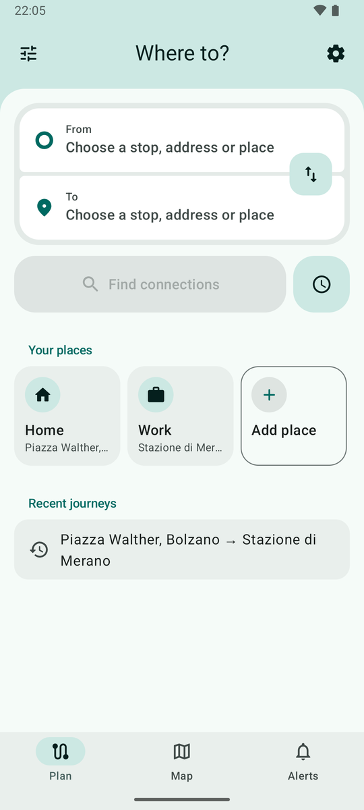 Plan</td>
    <td align="center">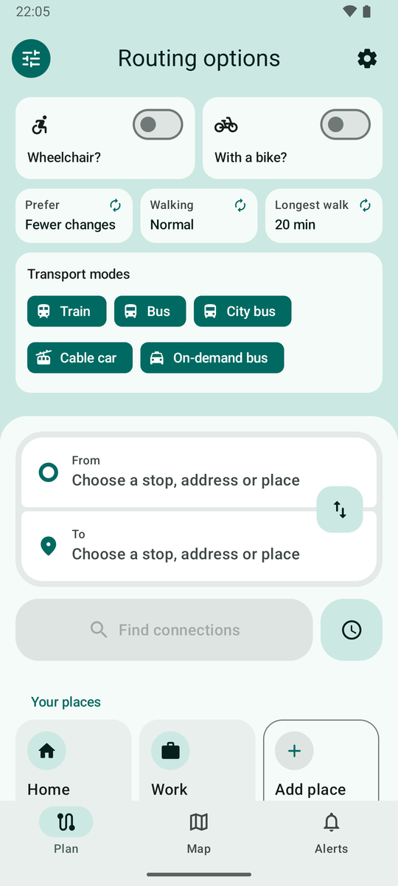 Routing options</td>
    <td align="center">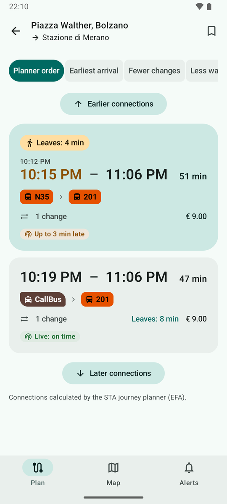 Journey results</td>
  </tr>
  <tr>
    <td align="center">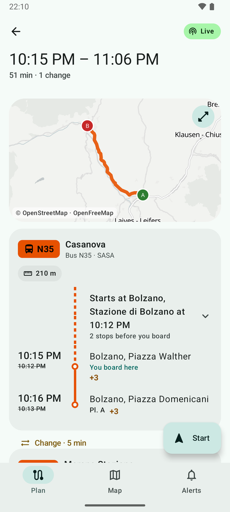 Journey detail</td>
    <td align="center">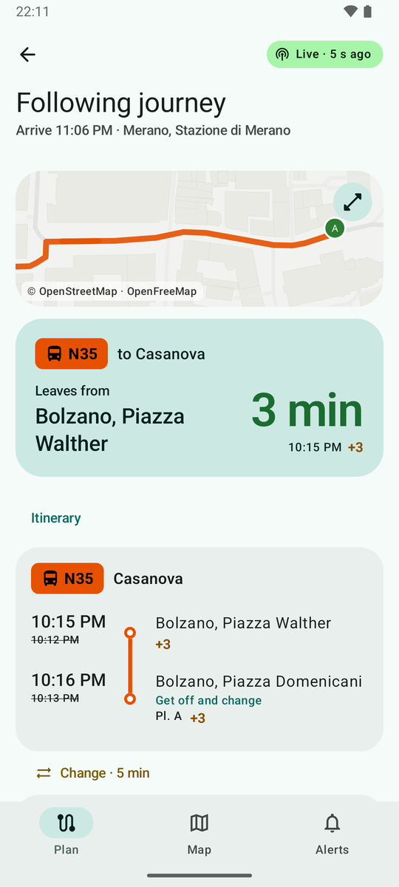 Following a journey</td>
    <td align="center">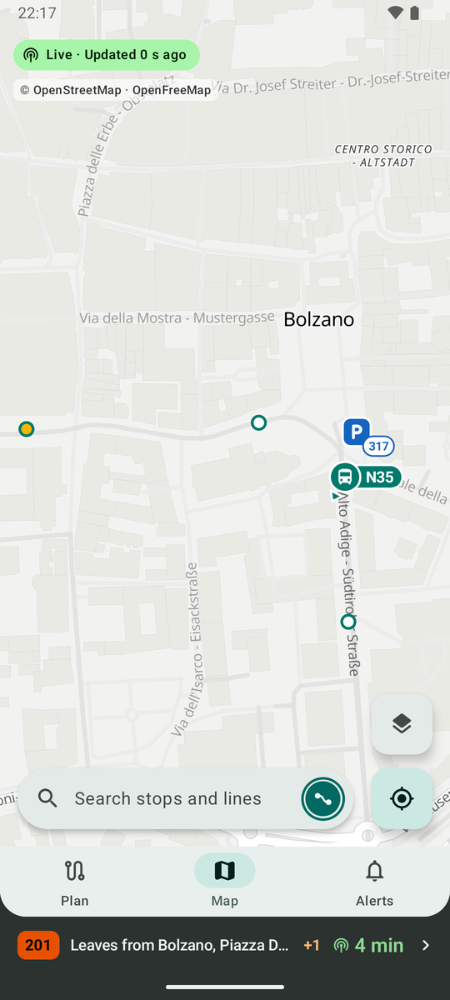 The journey, minimised</td>
  </tr>
  <tr>
    <td align="center">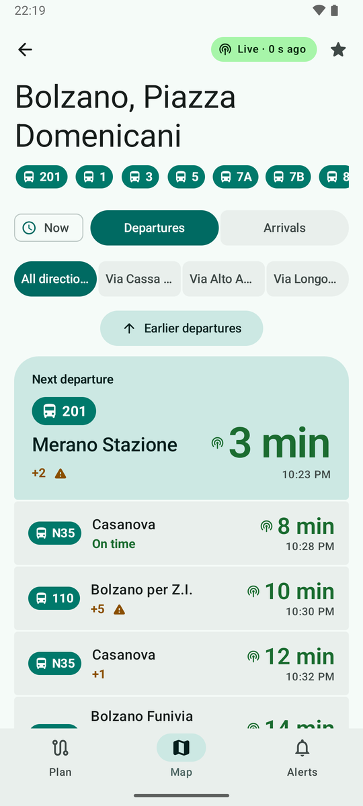 Live departure board</td>
    <td align="center">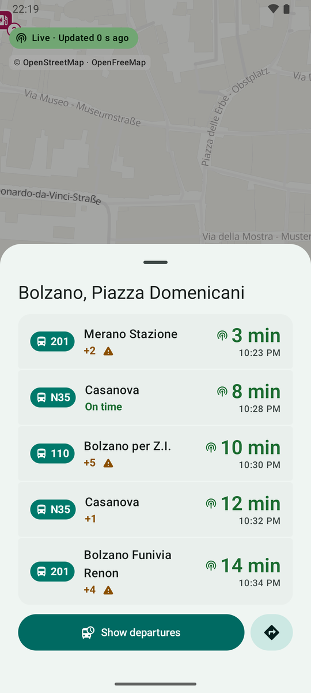 Map with stop preview</td>
    <td align="center">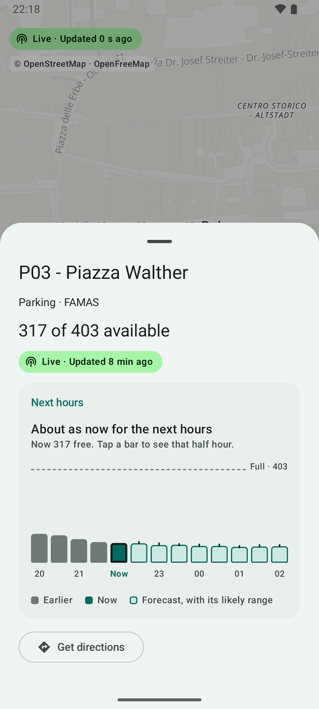 Car park forecast</td>
  </tr>
  <tr>
    <td align="center">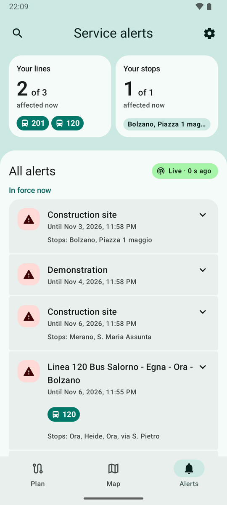 Service alerts</td>
    <td align="center">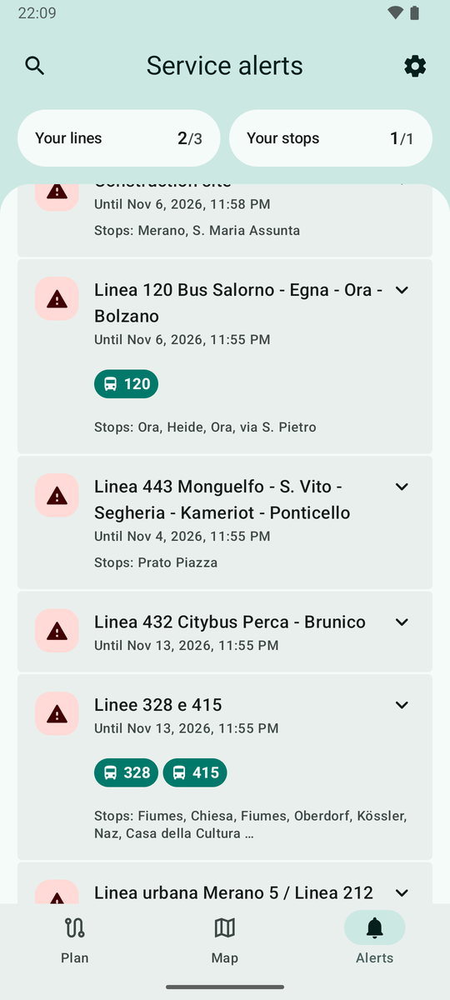 Alerts while scrolling</td>
    <td align="center">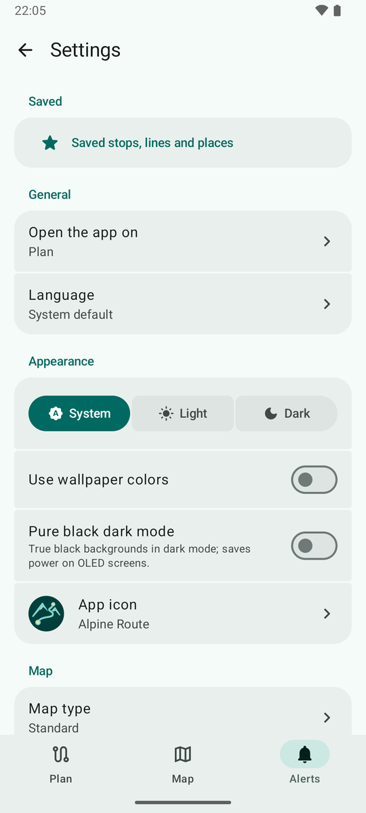 Settings</td>
  </tr>
  <tr>
    <td align="center">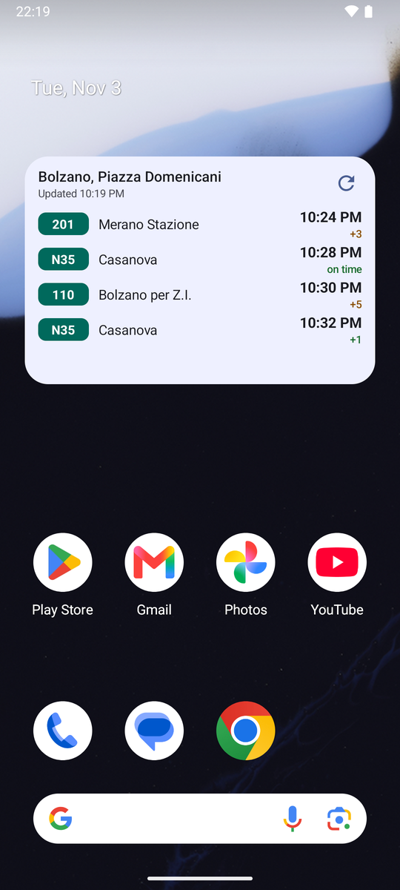 Home-screen widget</td>
    <td align="center" colspan="2">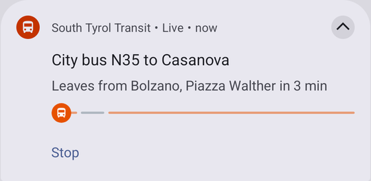 Ongoing notification while following</td>
  </tr>
</table>

## Screens

| Area | What it does |
|---|---|
| **First run** | Shown once, on a fresh install (an updated install goes straight to the app). Five steps under a progress bar: language, location permission, notices for saved stops and lines (with the notification permission), the offline timetable over Wi-Fi only or mobile data too, and a few preferences (start tab, theme, wallpaper colours, pure black, wheelchair default). Then a summary that follows the timetable download. Every step has Back and Skip, and each choice is saved as it is made |
| **Plan** (home) | A top lip in the muted secondary container instead of a top bar: the title opens on "South Tyrol Transit" and slides to "Where to?", the routing options button sits on its left and Settings on its right; the page below is a sheet with rounded top corners. The routing options open inside the lip, which grows and pushes the page down, and the title reads "Routing options" while they are open. The lip opens to the options' full height; a touch or scroll on the page below, or Back, closes it. In it, cards: "Wheelchair?" and "With a bike?" as switch tiles side by side, Prefer, Walking and Longest walk as cycle buttons (each tap moves to the next value, with a small press bounce, a turning arrow and the new value sliding in), then the transport modes. Connected From/To hero with a swap button. Place search (stops, addresses, POIs) in a bottom sheet with "use my location", "pick on the map" (any point or a stop), your places and recents; a star on each result saves it as Home, Work or a place of your own with a name and one of twelve icons. Departure time is one button to the right of Find connections: the clock icon alone means leaving now; a tap opens the date and time pickers, after which the button widens to show the chosen time (time only for today, short weekday and time otherwise) and turns primary, with depart at / arrive by above the row; while a time is set, a × at the end of the button (and "Leave now" in the date picker) goes back to now. Preferences: fewer changes (the default), fastest, less walking. Mode filters, walking speed, longest walk to a stop (10, 20 or 30 min; 20 by default), wheelchair option, "Travelling with a bike" (hides connections whose matched timetable run takes no bikes; needs the downloaded timetable). "Your places": a sideways-scrolling row of cards with Home, Work, your own places in your order and "Add place"; a tap finds connections from your current location to the place, leaving now, and a long press opens a small FAB-style menu with "Arrive here" and "Start from here". All cards, "Add place" included, have the same height. Saved and recent journeys. Tickets entry |
| **Results** | Journey cards with large dep/arr times, duration, changes, walking, a line chain, live/delay/cancel/notice pills and planner fares. The soonest connection that can still be caught is emphasised with a "Leaves: …" pill; connections that have left are dimmed and marked "Departed". Sorting in a connected button group, earlier/later. Save the journey. Two-pane list/detail on wide screens |
| **Journey detail** | The journey's times are the title of the top bar, duration and changes its subtitle, with the one live/scheduled pill beside them. Map of all legs (walking dashed) and a timeline. Transit legs show line, destination, operator, platforms, scheduled vs live times, the train number, distance and bike rule of the matched timetable run (with a warning when travelling with a bike and the rule is unknown) and expandable intermediate stops, drawn like an opened trip (rail, stop dots, passed stops dimmed, the vehicle before the next stop). Transfer times and leg notices. Above the boarding stop, a row says where the approaching vehicle is ("Bus 211 is 3 stops away", live or estimated) and opens the run's earlier stops with their times on a dashed rail; trains show the times only, as they report no position. The map shows the approaching vehicle too. Fares only when the planner reports them. **Start** follows the journey |
| **Following a journey** | Started from the journey detail; one journey at a time, reopened from the notification or from the strip under the navigation bar, which shows the current step on every other screen (red when the plan breaks). Shows the current step (leaves from, get off at, change at, walk to) with a countdown, then every leg of the itinerary (done ones dimmed, the current one open with its stops), and a map zoomed on the current step. Live times where a timetable run is matched (GTFS-RT), otherwise the planner's times, marked as such. Warns when a leg is cancelled, a connection can no longer be made, or (with the optional location) a boarding was missed or the route left, and offers "Find another way". An ongoing notification with Stop shows the step; on Android 16+ it is a Live Update with a progress bar per leg and a status bar chip. Runs in a foreground service only while following; ends by itself on arrival, and is lost if Android ends the app |
| **Following a ride** | One bus or train run pinned from the map's vehicle sheet ("Follow this ride") or from its trip screen ("Follow ride"). Shares the journey's single slot: following a ride while a journey or another ride is followed first asks whether to follow it instead. The same strip under the navigation bar shows where the run is on every other screen (leaves from, next stop, at a stop, last seen near a stop when its GPS position is not current, red when it is cancelled) and opens its trip, where a card on top says the same with a countdown and the last stop, and Stop following sits at the bottom. The position comes from the vehicle's GPS when there is one, otherwise it is estimated from live times or the timetable and said so, so trains can be followed too. An ongoing notification with Stop says the same; on Android 16+ a Live Update with the run's progress and a status bar chip counting down to the next stop. Ends by itself a minute after the last stop (or a cancellation), leaving a final notice; is lost if Android ends the app |
| **Stop** | Live departures/arrivals with countdown, delay text, platform, train number, bike symbol, cancellation and alert flags; on the live departure board the next departure is a large hero card heading the list, with "Bikes allowed" and the distance to its destination when the timetable gives them. Below the served lines (one sideways-scrolling row of filter badges, saved lines first): the time button, the same as on Plan (the clock icon alone for now; a chosen time widens it, in primary, with a × back to now), and the direction button ("All directions" or where the buses go next), which opens a sheet listing every direction in full: its main next stop with the second one under it. Departures/arrivals, where arrivals differ, sits beside the time button, or takes the whole first row when the stop also has directions; the wheelchair mark ends the first row. Earlier/later departures are tonal buttons, "earlier" right above the hero card. The freshness pill ("Live · 16 s") sits in the top bar beside the favourite. Pull to refresh. Platform map, favourite |
| **Trip** | One collapsed card above the timeline summarises this line's/run's service notices; tap it to expand every notice in full. Train number, run length and bike rule in the header; with a fresh GPS position, distance travelled and to go, and "Next stop in …". Stop-by-stop timeline with scheduled/predicted times, distance along the run per stop, skipped stops, next-stop highlight, live vehicle on the shape map with its age |
| **Lines** | Line search (also reached from the map's search). Line page with directions, ordered stops, shape map, live vehicles, upcoming trips, alerts, operator, favourite |
| **Map** | MapLibre (OpenGL ES) map with clustered stops (white dots ringed in their mode's colour; train and cable car stations become a disc with their icon from zoom 15, and a red badge marks a stop named by a service alert in force; the mode needs the downloaded timetable), live vehicles (mode icon with the line number and a bearing arrow, grey when stale, hidden after 10 min) and optional parking / car-sharing / EV charging / bike box / e-bike sharing / bike sharing layers, grouped in the layers sheet by public transport, car and bike, drawn as rounded-square icons with a live availability count when zoomed in; a charging station counts its free points, carries a bolt badge when it has a DC point of 50 kW or more and turns grey when every point is out of order. STA's bike boxes (Bicibox, a bike inside a box on dark cyan) count free boxes or depot places and, when a site is full, point to the nearest one nearby with space; Ecospazio's e-bike sharing stations count e-bikes to rent and free docks, and turn grey while closed. Saved stops highlighted. Four map types: Standard (OpenFreeMap Positron, Fiord in dark mode, Dark Matter with pure black), Detailed (OpenFreeMap Liberty, the same in every theme), and the Province of Bolzano's Aerial and Topographic maps, which cover South Tyrol only, from zoom 10, over the standard map. MapLibre logo/info button removed; a compact credit naming every source shown remains (ODbL). A search bar floats at the bottom, sharing the row with the "my position" button (or at the top, as chosen in Settings), with the ringed app mark at its end, which opens a Material FAB menu with Saved, the language (opening the language choices), the theme (each tap switches System, Light, Dark at once) and Settings, rising above the bar, or dropping below it when the bar is at the top; with the bar at the bottom the map credit moves to the top, under the live pill: tapping it covers the map with a search view (the bottom bar hides meanwhile) that shows saved stops, recent searches (the stops and lines last opened from it, newest first, with a Clear button) and nearby stops (location on demand), and while typing matching stops and lines; a stop opens its departure board, a line its line page, and back returns to the search, then to the map with the text cleared. Above the "my position" button, a layers button of the same size opens a sheet with the map type and the same layer toggles as Settings. With location allowed, the user's position is a blue dot that follows every fix while the map is on screen (GPS and compass stop in the background), with a halo for its accuracy and a cone that turns with the compass; the camera does not follow it. Besides these, only the "my position" button (muted secondary tone) floats over the map: a tap centres on the user, a long press opens the saved stops as a FAB menu, and picking one flies to the stop and opens its sheet (a one-time snackbar points this out once a stop is saved); the map type, which layers are shown, whether the layers button is shown, where the search bar sits and where that button sits (bottom right, bottom left or hidden) are chosen in Settings. An empty vehicle feed is noted in the freshness pill rather than a banner. Stop sheet with the next departures, a "Show departures" button and a directions icon button; vehicle sheet with line, destination, next stop, delay and freshness; charging-station sheet with its points grouped by connector, power and cable, each group's free count, opening hours, access and a payment link where the operator gives them; car park sheet with a "Next hours" bar chart (two hours measured, now, and the operator's forecast up to about three hours ahead with its likely range), tappable per half hour, for car parks that publish a forecast issued within the last 90 minutes |
| **Alerts** | Current and planned alerts merged from GTFS-RT and EFA AddInfo, deduplicated. A top lip like Plan's: search on its left, Settings on its right, and under the title two cards, "Your lines" and "Your stops", each with how many of your saved lines or stops have an alert in force now ("3 of 5"), how many more have one coming up, and the affected line badges or stop name. A tap on a card shows only those alerts, a second tap (or "Show all") shows all again. A card appears only while at least one of your saved lines or stops has an alert in force or coming up: with only one such card it spans the width, and with none the lip ends under the title. Scrolling the list slims the cards to one line (label and count, "3/5") to give the list more room; they grow back when you scroll to the top. Search opens at the bottom of the lip and filters by line, stop or word as you type; tapping a line badge on an alert searches for that line; Back or the search button closes and clears it. The page below groups the alerts into "In force now" and "Coming up", with the freshness pill next to the heading. Disruptions and other notices differ by the colour of their icon container, and affected lines show as line badges with their mode icon (lines named only in planner notices are looked up by name). Multilingual (de/it/en/lld) with a language switcher. Validity periods. Stale marking offline |
| **Saved** (in Settings) | Places, stops, lines, journeys and recents; add places, stops (search or map) and lines. Places list Home and Work first, then your own, which can be renamed, given another icon and moved up or down; any place can get a new location or be removed. Saved stops and lines drive the Alerts "Your lines" and "Your stops" cards and alert notifications. Stored on the device; saved items, settings and the app icon are included in the phone's automatic backup (Android 9+, end-to-end encrypted only; recents are not) |
| **Settings** (the gear in the top lip of Plan and Alerts, or the menu behind the app mark in the map's search bar) | Grouped lists under section headings, each setting on its own segment. One-of-many choices (start tab, language, "my position" button) are rows that open a choice dialog; the theme is a connected button group; the app icon is a row that opens a sheet with the variants; map layers stay filter chips (several can be on). Saved items, start tab, map layers, search bar position (bottom by default, or top) and "my position" button placement, language (system/en/de/it), theme (system/light/dark), pure black dark mode, wallpaper colors (off by default), wheelchair default, opt-in alert notifications, offline timetable status/download/mobile-data/FTP-fallback, app updates (Stable or Preview channel) |
| **Navigation** | Bottom tabs Plan / Map / Alerts (stop search lives in the map's search; a stored "Stops" start tab opens the map); Settings is a screen opened from the gear in the top lip of Plan and Alerts or from the menu behind the app mark in the map's search bar, not a tab. The tab stays selected inside its sub-views; tapping the current tab returns to its root. Sub-views slide in horizontally (Material shared-axis style) so predictive back animates them; tab switches and reduced-motion use a fade |
| **About / Tickets** | Unofficial disclaimer, data sources and licences, privacy. Explanation that tickets are sold by the official service, with a link |
